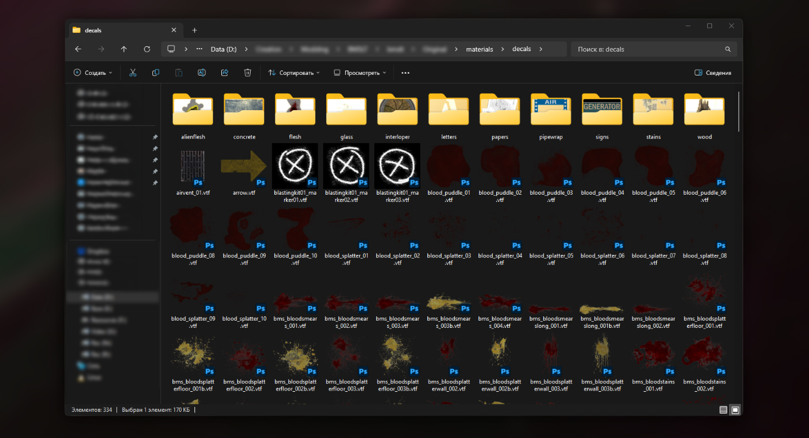

# VTFThumbnail — VTF thumbnails in Windows Explorer

[](https://github.com/haos9cr/VTFThumbnail/actions/workflows/tests.yml)

[Русская версия](README.ru.md)

Shows **Valve Texture Format (`.vtf`)** textures — Source engine: Half-Life 2, Counter-Strike: Source,
Garry's Mod, Team Fortress 2, Portal, … — as thumbnails in Windows Explorer, file dialogs and
anywhere else Windows shows thumbnails.



A small 64-bit shell extension (`IThumbnailProvider`). No VTFLib, no other DLLs, no Visual C++
runtime. Companion project: [VTFExport](https://github.com/haos9cr/VTFExport), a VTF plug-in for
Photoshop.

## Features

- VTF 7.0 – 7.5, almost every format: DXT1/3/5, DXT1 with 1-bit alpha, ATI1N/ATI2N, all 8-bit
  RGB(A)/BGR(A)/ABGR/ARGB/BGRX, 565/5551/4444, I8/IA88/A8, UV88/UVWQ/UVLX, bluescreen,
  HDR 16/32-bit (clamped to 0..1).
- **Fast on big textures:** only the header and one mip level are read — the smallest one that
  is still at least as big as the thumbnail — instead of the whole file. Textures without mipmaps
  are decoded at full size (up to 8192×8192).
- Sharp, correct downscaling (area average, alpha-weighted so transparent pixels don't bleed).
  Aspect ratio is kept; small textures are not blown up.
- **Alpha:** shown as transparency, except on normal maps and SSBump maps, where alpha is a mask
  (specular, etc.) and would make the thumbnail look half-empty. See [Settings](#settings).
- Animated textures: frame 1. Cubemaps: the first face. Volume textures: the first slice.
- Broken or truncated files simply get no thumbnail.

## Installation

1. Download `VTFThumbnail-<version>.zip` from [Releases](../../releases) and unpack it where it
   will stay, for example `C:\Program Files\VTFThumbnail\`. Explorer loads the DLL from that
   folder, so don't move or delete it afterwards.
2. Run `install.cmd`:
   - *Right-click → Run as administrator* — for all users;
   - double-click — only for your account (no administrator rights needed).
3. Open a folder with `.vtf` files in *Large icons* view.

`install.cmd` just runs `regsvr32 VTFThumbnail.dll`. Requires 64-bit Windows 7 or newer
(developed for Windows 10 / 11).

### Uninstall / update

Run `uninstall.cmd` (as administrator if you installed for all users), then delete the folder.
If Windows says the DLL is in use, sign out and back in (or restart Explorer) first. To update,
uninstall, replace the DLL, install again.

If another program had registered its own `.vtf` thumbnail handler, it is restored on uninstall.

## Settings

`HKEY_CURRENT_USER\Software\VTFThumbnail` (or `HKEY_LOCAL_MACHINE\…` for all users), `DWORD`:

| Value | Meaning |
|---|---|
| `AlphaMode` = `0` | auto (default): transparency, except normal / SSBump maps |
| `AlphaMode` = `1` | always show alpha as transparency |
| `AlphaMode` = `2` | always opaque (ignore alpha) |

```
reg add HKCU\Software\VTFThumbnail /v AlphaMode /t REG_DWORD /d 2 /f
```

Windows caches thumbnails: after changing the setting, clear the cache (*Disk Cleanup →
Thumbnails*) to see existing files with the new setting.

## Troubleshooting

- **Only icons, no thumbnails** — *Folder options → View →* uncheck *Always show icons, never
  thumbnails*; use a view with large icons.
- **Old / wrong thumbnails** — clear the thumbnail cache (*Disk Cleanup → Thumbnails*).
- **Still nothing** — another program may have a handler for `.vtf` on its file type (ProgID).
  Check `HKEY_CLASSES_ROOT\.vtf` and the key named in its default value for a
  `ShellEx\{E357FCCD-A995-4576-B01F-234630154E96}` subkey, and open an
  [issue](../../issues) with what you find.

## Building

Visual Studio 2022 (or newer) with *Desktop development with C++*: open `VTFThumbnail.sln`,
choose **Release | x64**, build. The DLL is `bin\Release\VTFThumbnail.dll`.
`tools\make_release.ps1` packs it with the scripts into `dist\VTFThumbnail-<version>.zip`.

On Linux, `./build.sh` cross-compiles the same DLL with MinGW-w64.

### Tests

```
pip install srctools pillow
tests/run_tests.sh          # thumbnail code vs srctools + Pillow, fuzzing with ASan/UBSan
tests/run_tests.sh --wine   # + the real DLL under Wine, driven like Explorer; regsvr32
```

The core tests build VTFs with srctools (formats, versions 7.2 – 7.5, mipmaps, odd sizes,
animation, cubemaps, alpha modes) and compare every thumbnail with srctools' decoding of the
expected mip level and an independent area-average reference. Broken and truncated files must
be rejected without crashing.

### Layout

| | |
|---|---|
| `src/Thumbnail.*` | VTF → thumbnail (portable: mip choice, decoding, downscale) |
| `src/ThumbnailProvider.cpp` | `IThumbnailProvider` + `IInitializeWithStream` |
| `src/Dll.cpp` | class factory, DLL exports, `regsvr32` registration |
| `src/vtf/` | dependency-free VTF reader (header, mip lookup, all decoders) |

## Contributing

Bug reports with the texture attached are very welcome — see [CONTRIBUTING.md](CONTRIBUTING.md).

## License

[MIT](LICENSE). See [THIRD_PARTY_NOTICES.md](THIRD_PARTY_NOTICES.md).
